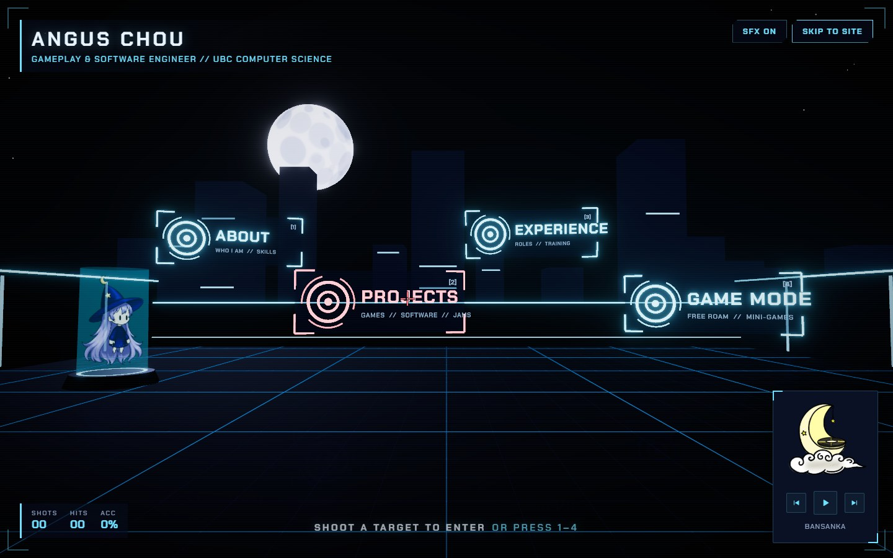
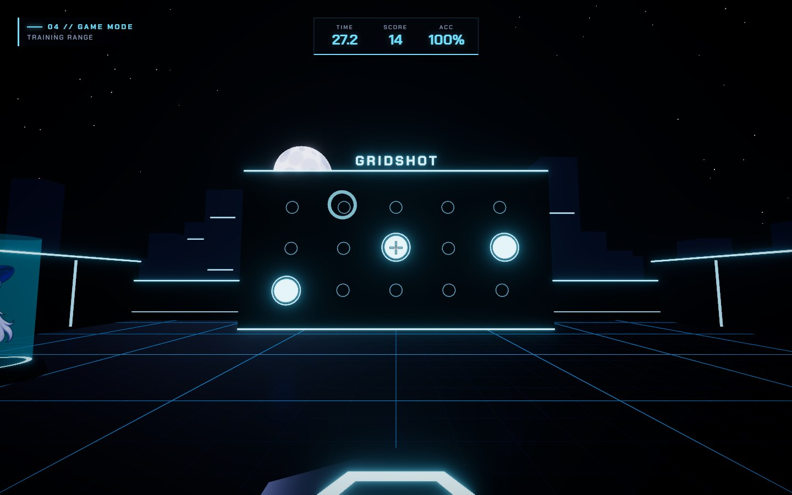
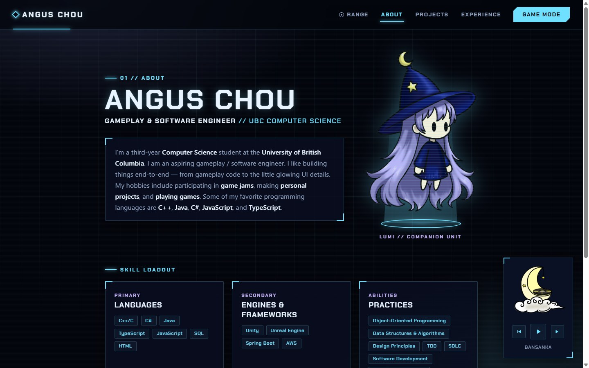
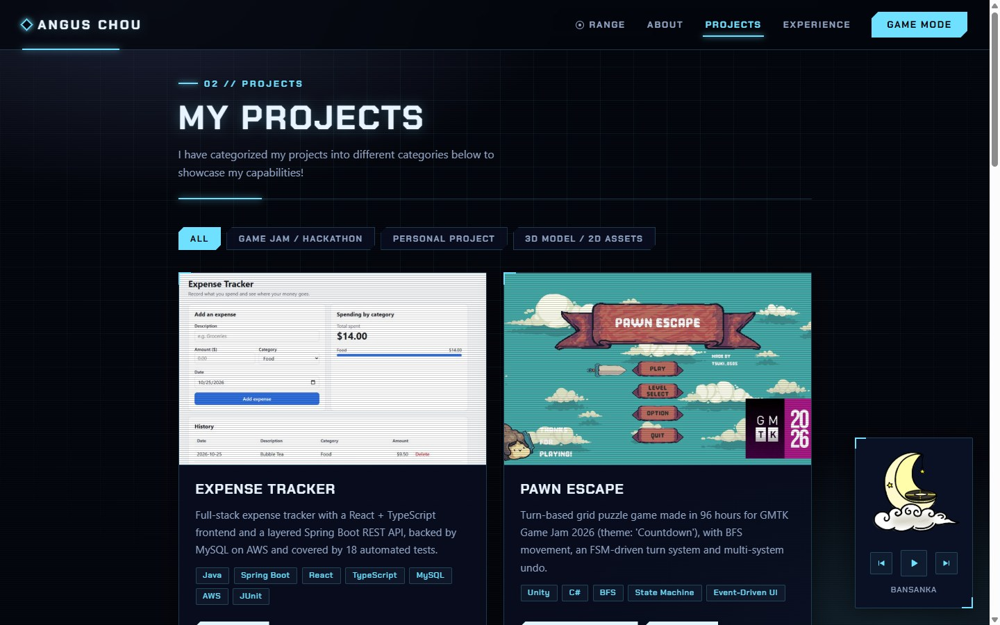
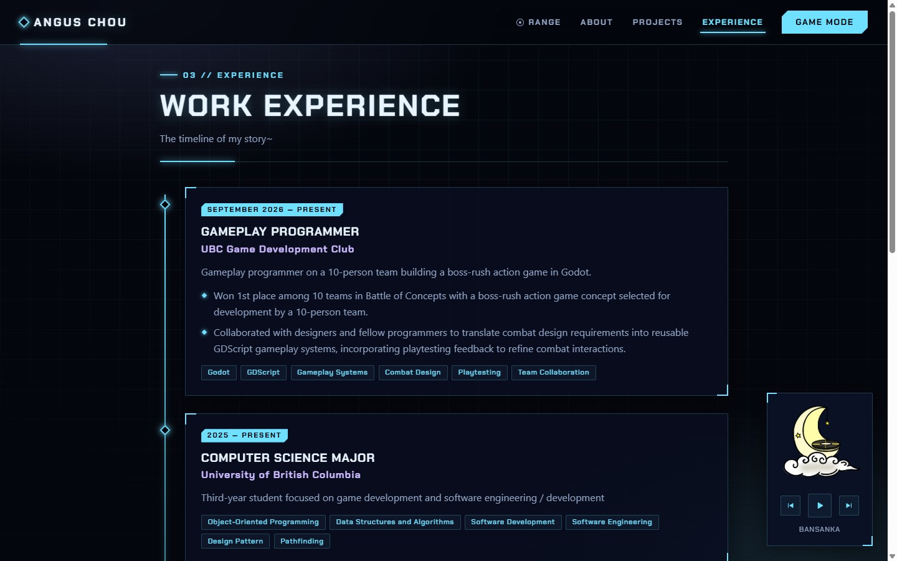
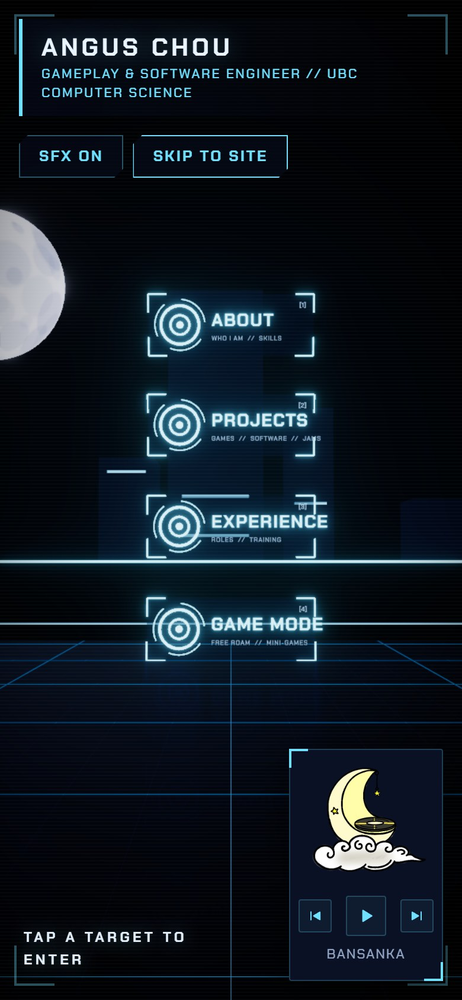
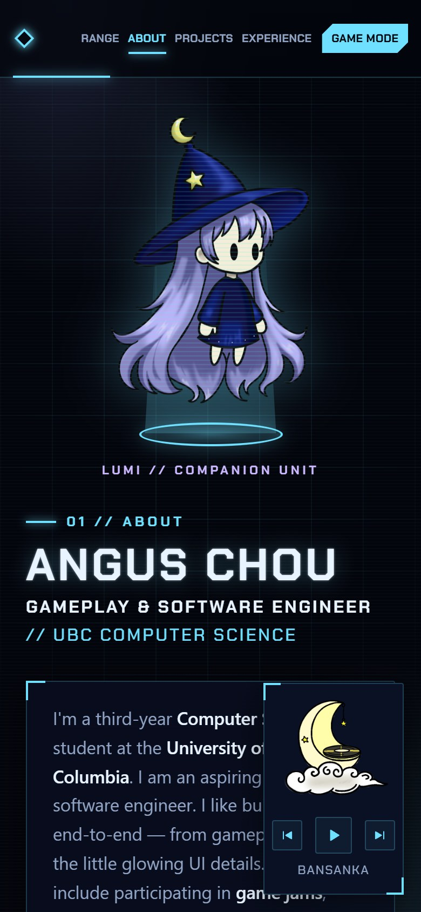

# Angus Chou — Portfolio Firing Range

An interactive portfolio built as a **first-person shooter**. Visitors land in a 3D lunar firing range, aim with a crosshair, and **shoot holographic targets** to open my About, Projects and Experience pages, or drop into a playable **Game Mode** with a Gridshot aim trainer.

**[Live site → angus-personal-website.vercel.app](https://angus-personal-website.vercel.app/)**  ·  [Software resume](https://angus-personal-website.vercel.app/Angus_Chou_Resume_Software.pdf)  ·  [Gameplay resume](https://angus-personal-website.vercel.app/Angus_Chou_Resume_Game.pdf)



> In a hurry? Press **Skip to site** in the top-right corner, or keys **1–4**, to jump straight to a section.

---

## What it shows

| | |
| --- | --- |
| **Gameplay programming** | First-person controller with pointer-lock mouse look, WASD movement, jumping and collision; a full Gridshot game loop with countdown, scoring, accuracy and a saved best score. |
| **3D / graphics** | Real-time Three.js scene (via React Three Fiber) with raycast hit detection, bloom, a reflective floor, instanced geometry and procedurally generated textures and sound. |
| **Performance work** | Profiled with a scripted Chrome DevTools harness and added automatic quality tiers, so the site stays smooth from high-end GPUs down to laptops without graphics acceleration. |
| **Front-end engineering** | React 19 + TypeScript with lazy-loaded 3D code, a data-driven content layer, responsive layouts and keyboard/touch support. |
| **Design** | Original HUD-style UI and hand-drawn art (Lumi, the music player) built without a UI library. |

---

## Features

### Firing range landing
- Fixed-camera 3D range under a moonlit skyline with a holographic Lumi on a pedestal.
- Custom crosshair that **locks on** (turns red) over targets, kicks on each shot, and flashes a hit marker on a hit.
- Each shot draws a tracer and leaves an impact mark; a hit shatters the target and transitions into that page.
- Synthesized gunshot and hit sounds (Web Audio API, no audio files), a shots/hits/accuracy HUD, and an SFX toggle.
- **Accessible alternatives:** number keys 1–4, a Tab-key menu, **Skip to site**, and tap-to-select on phones with a portrait layout.

### Game Mode — Gridshot aim trainer


- Walk the range in first person: mouse look (pointer lock), WASD, Shift to walk, Space to jump, with collision against walls and props.
- Walk to the console and press **E** to start a 30-second round: three live targets on a 5×3 wall, each hit spawns a new one.
- Live HUD (time, score, accuracy), a results card with a **New best!** callout, and a best score saved in the browser.
- Pause menu with a sensitivity slider (saved), SFX toggle, and Exit to Range. Touchscreens get a keyboard-and-mouse notice instead.

### Portfolio pages
| About | Projects |
| --- | --- |
|  |  |

| Experience | Phone |
| --- | --- |
|  |   |

- **About:** bio, a floating Lumi hologram, and a **Skill Loadout** grouped into Languages, Engines & Frameworks, and Practices.
- **Projects:** filterable cards with thumbnails and clearly labelled links (GitHub, Play on itch.io, Live Site), ordered by relevance.
- **Experience:** a timeline with highlight bullets for each role.
- **Contact & Resume:** social links plus separate **Software** and **Gameplay** resume downloads.
- **Music player:** a hand-drawn CD player that streams a playlist through the YouTube IFrame API.

---

## Engineering highlights

- **Raycast shooting.** Shots are resolved with a single raycast against target hit planes and world geometry; the result drives the tracer, impact decal, hit marker, sound and navigation.
- **Measured, adaptive performance.** I wrote a Chrome DevTools Protocol script that loads the production build, toggles individual effects and records frame times. Findings and fixes:
  - The reflective floor and bloom were the main cost on weak hardware. **Automatic quality tiers** (high → medium → low) now step down based on live frame rate, and browsers without GPU acceleration start on low. In a software-rendered browser the range went from **~4 fps to ~69 fps**.
  - The skyline is drawn with **instanced meshes**, and decorative lights were removed, cutting draw calls from **299 to 219** with no visible change.
  - A ~30 ms stutter on the first shot was traced to Web Audio start-up; the audio context is now warmed up during idle time (worst frame while shooting: **~7 ms**).
  - React re-renders are isolated with `memo`, so a shot only re-renders its effects, not the whole scene.
- **Fast first load.** The 3D engine is code-split and lazy-loaded; the rest of the site ships in about 68 KB (gzipped), and Game Mode adds only about 6 KB on top of the shared 3D bundle.
- **Small, testable game state.** Gridshot's round logic (phases, timing, target spawning, scoring) lives in a framework-free store that both the 3D scene and the HUD subscribe to.

---

## Tech stack

| Area | Tools |
| --- | --- |
| Framework | React 19, TypeScript, Vite |
| 3D | Three.js, React Three Fiber, drei, postprocessing (bloom, tone mapping) |
| Audio / media | Web Audio API (synthesized SFX), YouTube IFrame API |
| Styling | Hand-written CSS (no UI library), Chakra Petch font |
| Art | Clip Studio Paint (Lumi, music player) |
| Tooling | ESLint, Chrome DevTools Protocol (profiling and screenshots), GitHub, Vercel |

---

## Run it locally

Requires Node.js 20.19+.

```bash
git clone https://github.com/tsuki9355/My-Website.git
cd My-Website
npm install
npm run dev
```

Then open http://localhost:5173. Use `npm run build` for a production build and `npm run lint` to lint.

### Controls

| Firing range | Game Mode |
| --- | --- |
| Mouse — aim · Click — shoot | WASD — move · Mouse — aim · Click — shoot |
| 1–4 — shoot a target · M — toggle SFX | Space — jump · Shift — walk · E — use console |
| Tab — keyboard menu | Esc — pause |

---

## Project structure

```
src/
├── range/        3D firing range landing (scene, targets, shot effects, quality tiers, SFX)
├── game/         Game Mode: player controller, Gridshot store and scene, HUD
├── pages/        About, Projects and Experience pages
├── components/   Navbar, footer, project/experience cards, music player, page header
├── data/         Projects, experience and playlist content
└── styles/       Shared HUD theme
public/           Resumes, fonts, project thumbnails, hand-drawn art
docs/screenshots/ Images used in this README
```

---

## Credits

- Lumi and the music player art are hand-drawn by me.
- [Chakra Petch](https://fonts.google.com/specimen/Chakra+Petch) font by Cadson Demak, used under the SIL Open Font License.
- Music is streamed from YouTube through the IFrame API; tracks belong to their respective artists.

---

**Angus Chou** — Computer Science @ University of British Columbia
[GitHub](https://github.com/tsuki9355) · [itch.io](https://tsuki-0505.itch.io) · [Portfolio](https://angus-personal-website.vercel.app/)
